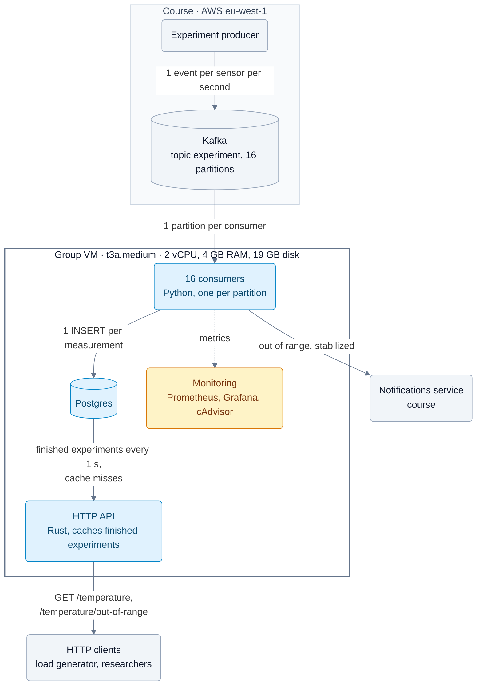

# Temperature Observability, group 11

Python consumers read experiment events from Kafka, store averaged measurements in Postgres and notify researchers. A Rust HTTP API serves the stored measurements. Everything runs with Docker Compose on the group VM (`docker compose up -d --build`).

## Architecture



## Consumers

## Notifications

## HTTP API

Rust service in [`src/http-api-rust`](src/http-api-rust) on port 3003, built on axum and tokio with tokio-postgres and a deadpool connection pool. Compose builds it because `.env` sets `API_IMPL=rust`. [`src/http-api`](src/http-api) contains the earlier FastAPI version with the same endpoints, SQL and responses. `API_IMPL=` deploys that one instead.

### Endpoints

| Request | Returns |
|---|---|
| `GET /temperature?experiment-id=<id>&start-time=<ts>&end-time=<ts>` | Measurements with `start-time <= timestamp <= end-time` |
| `GET /temperature/out-of-range?experiment-id=<id>` | Measurements whose temperature was outside the experiment's range |

Timestamps are Unix seconds. A measurement is the average over all sensors of the experiment. Only measurements from the experiment phase are stored, not from stabilization. Both endpoints return a JSON array sorted by timestamp, or `[]`:

```json
[{"timestamp": 1727512345.0, "temperature": 21.4}]
```

A missing or non-numeric parameter returns 422 with a FastAPI-style error body. A database error or timeout returns 500.

### Request path

Postgres builds the response JSON with `json_agg`, so the API forwards text and never parses rows.

A terminated experiment can't change, so the API caches finished experiments. A background task reads `experiments_terminated` every second and keeps the 8,000 most recently terminated experiments in memory, loading 100 per query. For each experiment it stores:
- the sorted timestamps;
- all rows as pre-rendered JSON fragments, with the offset where each row starts;
- the complete out-of-range response.

A time range request is then two binary searches and one memory copy. An out-of-range request returns the stored response. Running experiments and experiments not yet loaded go to Postgres, which uses the `(experiment_id, timestamp)` index.

The service is one process with `WORKERS` threads (2 on the VM). All threads share one cache, an `RwLock<HashMap>` that is locked only for the lookup, and one pool of `WORKERS × POOL_SIZE` = 20 connections. The Python version needs one process per core, each with its own cache and pool.

### Failure handling

A request may spend at most `DB_TIMEOUT` (5 s) on the database, including the wait for a pooled connection, and then returns 500. Before this limit, requests waited indefinitely when Postgres stalled. They kept their client connections open until the service ran out of file descriptors and accepted no connections. Compose also raises the open file limit to 65,536, because Docker's default of 1,024 ran out at about 1,000 concurrent connections. A cache refresh is aborted after 60 s, so a hung query can't stop later refreshes. On SIGTERM the server finishes open requests before it exits.

### Performance

On the VM the API served 10,385 req/s for finished experiments, with p99 latency of 28 ms and no failed requests. It used 0.51 of the 2 cores; the load generator ran on the same VM ([results](loadtest/results/vm-20261105-api.md)). Local comparison with the Python version, 2 workers each, 64 connections:

| Request | Python | Rust |
|---|---|---|
| finished experiment (cache) | 8,455 req/s | 35,224 req/s |
| running experiment (Postgres) | 2,693 req/s | 7,236 req/s |

Configuration and running without Docker: [`src/http-api-rust/README.md`](src/http-api-rust/README.md).

## Database

## Bottlenecks and learnings

Measured on the VM with experiments of 2 sensors at 1 sample/s ([load test](loadtest/README.md)). The consumers handle 450 concurrent experiments, about 1,000 events/s, with notification p99 of 0.9 s. At 500 experiments notifications arrive late. The required 100 experiments use about 40% of the CPU, with notification p99 of 0.4 s.

| Bottleneck | Limit | Raise it with |
|---|---|---|
| VM CPU, 2 vCPU | Full at about 1,000 events/s, 1.4 ms CPU per event. Reached first. | A larger instance, cheaper events |
| Consumers | Python, one message at a time: 1.1 ms CPU per event | Batched inserts, a compiled consumer |
| Postgres | One commit per insert: 0.3 ms CPU per event | Commits per batch, a separate host |
| Kafka | 16 partitions, set by the course: at most 16 consumers in parallel | Not in our control |
| CPU credits | t3a includes 20% per vCPU (0.4 cores), 100 experiments use about 0.7. Beyond the saved credits this costs $0.05 per vCPU hour, or the VM is throttled in standard mode | A non-burstable instance |
| Disk, 19 GB | About 40 KB per experiment | Cleanup, a larger volume |

The API (10,385 req/s at 0.51 cores) and the notifications (15 threads per consumer, about 0.1 s per request) never limited a test. Memory stayed at about 1.1 GB of 4 GB at the CPU limit.

What we learned:

1. On a 2 vCPU VM, capacity is set by CPU per event, not by the number of consumers. Sixteen processes can't use more than two cores, and scaling consumers inside the VM only adds rebalances, each of which pauses the partitions it moves. We replaced the autoscaler with 16 fixed consumers, one per partition, with static membership.
2. A partition can only move between consumers safely if the next owner knows the state. Experiment state lives in Postgres and offsets are committed only up to the oldest incomplete measurement, so a restart or handover loses no events, and events read twice have no effect.
3. After downtime, old events are worth less than new ones. A notification later than 10 s misses the requirement anyway, so after the whole group was down the consumers skip events older than 5 s instead of replaying the backlog.
4. Every wait needs a limit. The load test showed that requests without a database timeout, combined with Docker's default of 1,024 open files, could make the API stop accepting connections.
5. Moving the hot path out of Python paid off more than tuning it. With the same number of workers, the Rust API serves about 4 times as many cached requests as the FastAPI version.
