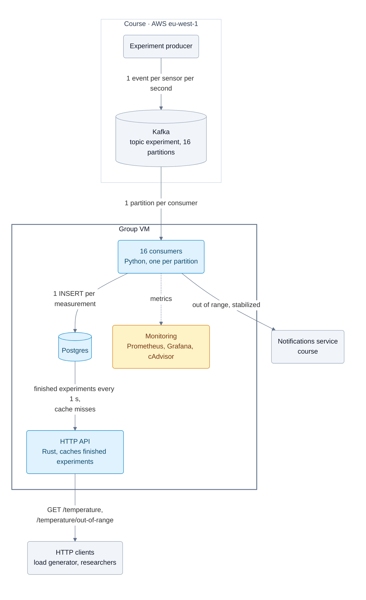

# Temperature Observability, group 11

Python consumers read experiment events from Kafka, store averaged measurements in Postgres and notify researchers. A Rust HTTP API serves the stored measurements. Everything runs with Docker Compose on the group VM (`docker compose up -d --build`).

## Architecture

## Consumers

## Notifications

## HTTP API

Rust service in [`src/http-api-rust`](src/http-api-rust) on port 3003, built on axum and tokio with tokio-postgres and a deadpool connection pool. Compose builds it because `.env` sets `API_IMPL=rust`. [`src/http-api`](src/http-api) contains the earlier FastAPI version with the same endpoints, SQL and responses. `API_IMPL=` deploys that one instead.

### Request path

Postgres builds the response JSON with `json_agg`, so the API forwards text and never parses rows.

A terminated experiment can't change, so the API caches finished experiments. A background task reads `experiments_terminated` every second and keeps the 8,000 most recently terminated experiments in memory, loading 100 per query. For each experiment it stores:
- the sorted timestamps;
- all rows as pre-rendered JSON fragments, with the offset where each row starts;
- the complete out-of-range response.

A time range request is then two binary searches and one memory copy. An out-of-range request returns the stored response. Running experiments and experiments not yet loaded go to Postgres, which uses the `(experiment_id, timestamp)` index.

The service is one process with `WORKERS` threads (2 on the VM). All threads share one cache, an `RwLock<HashMap>` that is locked only for the lookup, and one pool of `WORKERS × POOL_SIZE` = 20 connections. The Python version needs one process per core, each with its own cache and pool.

### Failure handling

- **Database timeout.** A request may spend at most `DB_TIMEOUT` (5 s) on the database, including the wait for a pooled connection, and then returns 500. Without it, requests waited indefinitely when Postgres stalled and kept their client connections open until the API ran out of file descriptors.
- **Open file limit.** Compose raises it to 65,536. Docker's default of 1,024 ran out at about 1,000 concurrent connections.
- **Cache refresh.** A refresh is aborted after 60 s, so a hung query can't block later refreshes.
- **Shutdown.** On SIGTERM the server finishes open requests before it exits.

### Performance

On the VM the API served 10,385 req/s for finished experiments, with p99 latency of 28 ms and no failed requests. It used 0.51 of the 2 cores; the load generator ran on the same VM ([results](loadtest/results/vm-20261105-api.md)). Local comparison with the Python version, 2 workers each, 64 connections:

| Request | Python | Rust |
|---|---|---|
| finished experiment (cache) | 8,455 req/s | 35,224 req/s |
| running experiment (Postgres) | 2,693 req/s | 7,236 req/s |

Configuration and running without Docker: [`src/http-api-rust/README.md`](src/http-api-rust/README.md).

## Database

## Bottlenecks and learnings

The VM handles 450 concurrent experiments, about 1,000 events/s, with notification p99 under 1 s. The requirement is 100 ([load test](loadtest/README.md)).

| Bottleneck | Limit |
|---|---|
| VM CPU, 2 vCPU | 1.4 ms CPU per event: 1.1 ms in the consumer, 0.3 ms in Postgres. Reached first. |
| Kafka | 16 partitions, so at most 16 consumers in parallel |
| CPU credits | The instance includes 0.4 cores; 100 experiments use about 0.7 |

1. On 2 vCPUs, capacity depends on CPU per event, not on the number of consumers. More consumers only add rebalances.
2. Keeping experiment state in Postgres and committing only completed work lets a partition move to another consumer without losing events.
3. Every wait needs a limit. Without a database timeout, and with Docker's default open file limit, the API stopped accepting connections under load.
