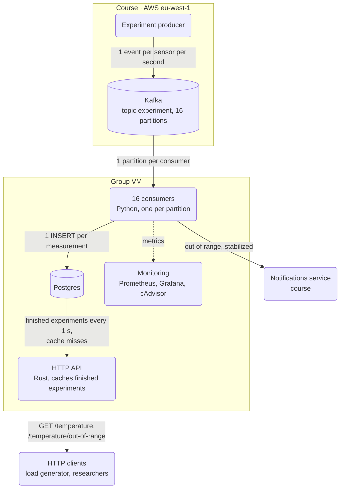

# Temperature Observability, group 11

Python consumers read experiment events from Kafka, store averaged measurements in Postgres and notify researchers. A Rust HTTP API serves the stored measurements. Everything runs with Docker Compose on the group VM (`docker compose up -d --build`).

## Architecture

## Consumers

Consumer's code is responsible for consuming events (sensor measurements for multiple experiments) from Kafka message broker, handling each experiment's state, averaging measurements, calling the notifier api for events that must be reported and finally storing the avg. measurements into a postgreSQL database in order to let the HTTP-API process them. We use a fixed number of consumer that are consuming from the Kafka's partitons. Some key points of the implementations are the following:

- 16 consumers in the same Kafka consumer group, one per partition. Events are keyed by experiment ID, so all events of an experiment are processed by the same consumer.
- Experiments are represented through a custom data structure containing information about the current state, nummber of sensors, etc.
- Each consumer holds a in-memory dictionary of experiments which is used for averaging measurements and calling the notifier component when it is needed (stabilization and out-of-range events).
- Only avg. measurements are then persisted to the deployed database. 

## Notifier

The single-consumer integrates `notifier.py` to notify the Notifications Service via HTTP POST requests whenever temperature thresholds trigger alerts:
1. **`Stabilized`**: Sent during the `stabilization_started` phase when the average temperature first reaches the experiment's target range `[lower_threshold, upper_threshold]`.
2. **`OutOfRange`**: Sent during the `experiment_started` phase whenever the average temperature exceeds the upper threshold or drops below the lower threshold.

Notifications are dispatched asynchronously via a background thread pool (`ThreadPoolExecutor`), ensuring that the Kafka consumer loop is never blocked by HTTP calls and keeping alert latency well within the required 10-second SLO.

## HTTP API

Rust service in [`src/http-api-rust`](src/http-api-rust) on port 3003, built with axum and tokio. It replaced our first version in FastAPI ([`src/http-api`](src/http-api)).

- Postgres builds the response JSON. The API passes it through without parsing.
- Finished experiments can't change, so the 8,000 most recently terminated ones are cached in memory and refreshed every second. Running experiments are read from Postgres.
- One process with 2 threads, sharing the cache and a pool of 20 database connections.
- A request may spend at most 5 s on the database and then returns 500. Without this limit, a stalled database left requests hanging until the API stopped accepting connections.

On the VM it served 10,385 req/s with p99 latency of 28 ms ([results](loadtest/results/vm-20261105-api.md)). Locally it handles 2.7 to 4 times the requests of the FastAPI version.

## Database

Our Postgres stores two different tables: measurements (avg. measurements for each experiment with an additional flag that indicates whether they were out-of-range), and a table for the terminated experiments (a tuple is an experiment that is terminated, used in HTTP-API caching technique). All queries regarding the database creation are in `db_queries.sql` file.

## Bottlenecks and learnings

The VM handles 450 concurrent experiments, about 1,000 events/s, with notification p99 under 1 s. The requirement is 100 ([load test](loadtest/README.md)).

| Bottleneck | Limit |
|---|---|
| VM CPU, 2 vCPU | 1.4 ms CPU per event: 1.1 ms in the consumer, 0.3 ms in Postgres. Reached first. |
| Kafka | 16 partitions, so at most 16 consumers in parallel |
| CPU credits | The instance includes 0.4 cores; 100 experiments use about 0.7 |

1. On 2 vCPUs, capacity depends on CPU per event, not on the number of consumers. More consumers only add rebalances.
2. Keeping experiment state in Postgres and committing only completed work lets a partition move to another consumer without losing events.
3. Every wait needs a limit. Without a database timeout, and with Docker's default open file limit, the API stopped accepting connections under load.
